<div align="center">
  

  # Expense Bucket

  **Your budget, as a bucket of water.**<br>
  A local-first Android expense tracker that fills in your ledger for you, at home and on the road.

  
  
  
  
  

  https://github.com/user-attachments/assets/d6dc115c-132b-455d-b1ed-ae4aaa1e3870
  
  <sub>▶ 25-second tour: the water budget, notification capture, Suica import, and statistics</sub>
</div>

## Why Expense Bucket

Most budgeting apps show a number. Expense Bucket shows you **how much water is left in the bucket**. The monthly budget is drawn as live water: it drops with every expense, warms from sage to amber to rose as the bucket empties, and sloshes when you tilt the phone (accelerometer and spring physics).

It also does most of the typing for you:

- **Card notifications become entries.** Bank and wallet alerts turn into drafts. Tap **✓ Confirm** in the notification and the water level updates.
- **Tap a transit card to import it.** Hold a Suica or ICOCA card to the phone to read its ride history and balance. Pick the new trips and import them all in one go, converted to your home currency at the historical rate.
- **Share a screenshot, get a transaction.** Share a payment-success screen, a receipt photo, or a Taiwan e-invoice QR code. On-device OCR fills in the amount and merchant for you to review.
- **Travel without breaking the month.** Each trip is a project with its own budget, timeline, and category breakdown. Spread big tickets such as flights and hotels across several months.

Your ledger stays on your device. Google Drive backups are encrypted with your own password before they leave the phone.

## Screenshots

<table>
  <tr>
    <td align="center" width="33%">
      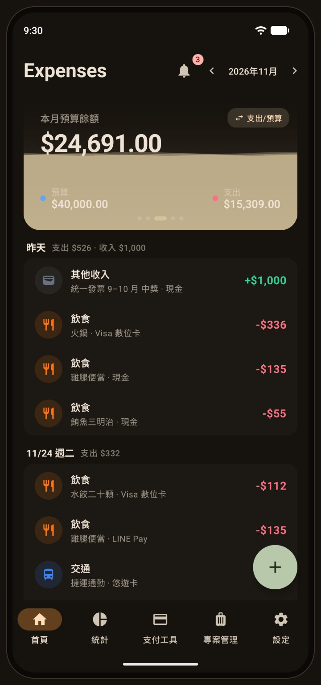<br>
      <strong>The water budget</strong><br>
      <sub>Remaining budget at a glance; the water warms as it drains</sub>
    </td>
    <td align="center" width="33%">
      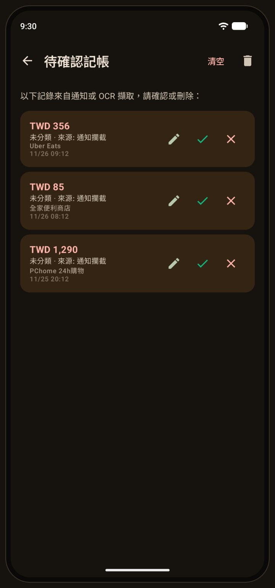<br>
      <strong>Notification capture</strong><br>
      <sub>Card and wallet alerts wait as drafts until you confirm them</sub>
    </td>
    <td align="center" width="33%">
      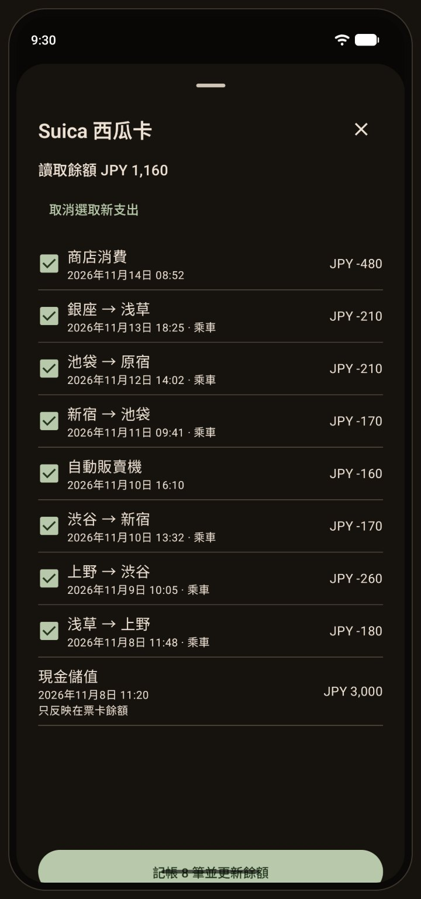<br>
      <strong>Transit card import</strong><br>
      <sub>Read Suica / ICOCA trips and balance over NFC</sub>
    </td>
  </tr>
  <tr>
    <td align="center" width="33%">
      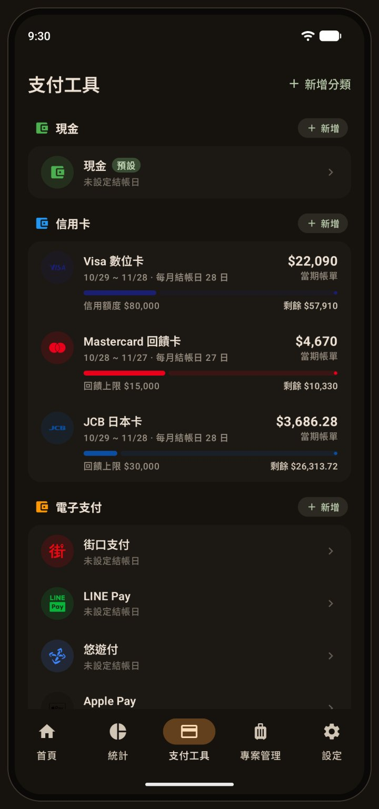<br>
      <strong>Cards and wallets</strong><br>
      <sub>Billing-cycle totals, credit and cashback limits, card balances</sub>
    </td>
    <td align="center" width="33%">
      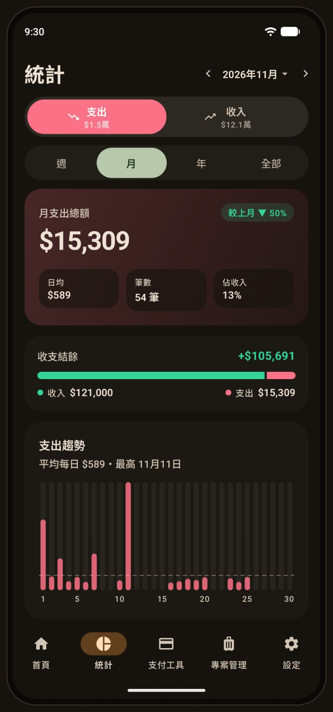<br>
      <strong>Spending statistics</strong><br>
      <sub>Daily trend, month-over-month change, share of income</sub>
    </td>
    <td align="center" width="33%">
      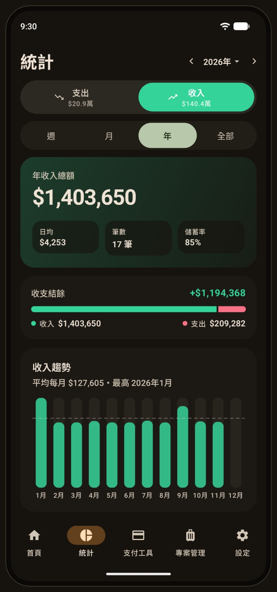<br>
      <strong>Income and savings</strong><br>
      <sub>Switch to income for the yearly trend and savings rate</sub>
    </td>
  </tr>
  <tr>
    <td align="center" width="33%">
      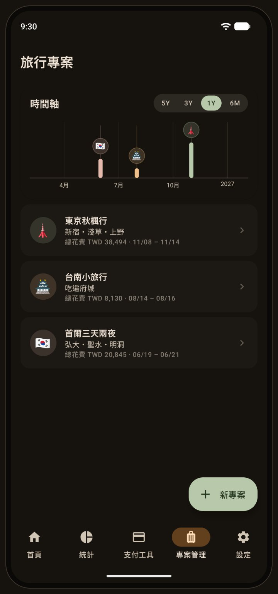<br>
      <strong>Trip timeline</strong><br>
      <sub>Every trip on one timeline with its total spend</sub>
    </td>
    <td align="center" width="33%">
      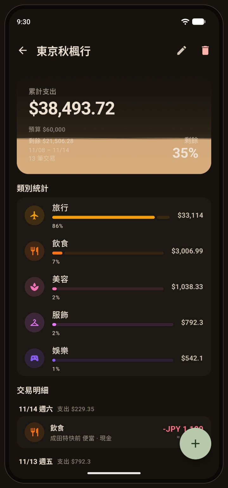<br>
      <strong>Trip budget</strong><br>
      <sub>Each trip has its own budget, categories, and history</sub>
    </td>
    <td align="center" width="33%">
      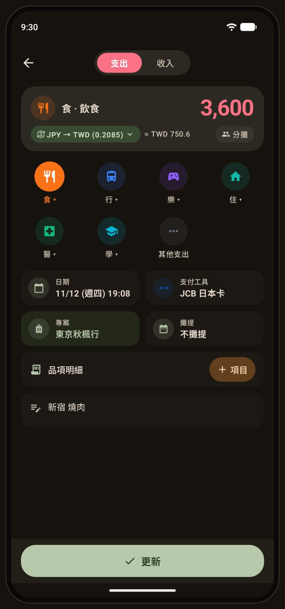<br>
      <strong>Multi-currency entry</strong><br>
      <sub>Historical cash rate for the transaction date</sub>
    </td>
  </tr>
  <tr>
    <td align="center" width="33%">
      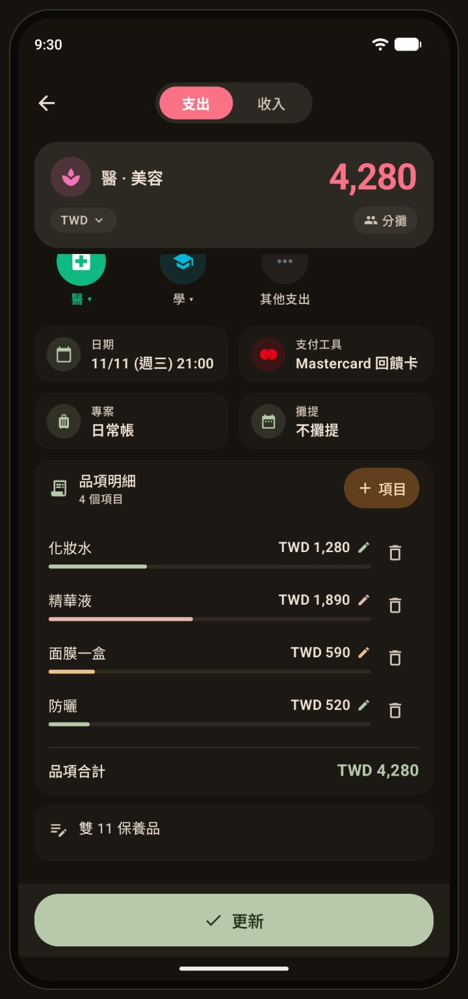<br>
      <strong>Itemised receipts</strong><br>
      <sub>Break one payment into line items</sub>
    </td>
    <td align="center" width="33%">
      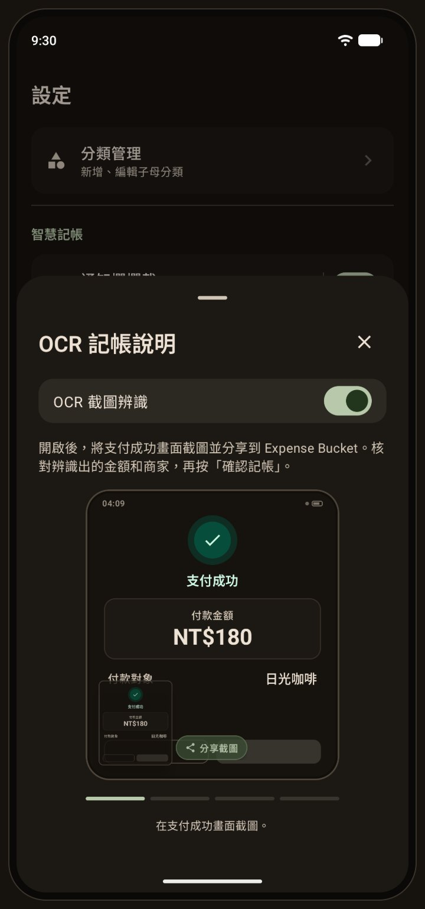<br>
      <strong>Screenshot OCR</strong><br>
      <sub>Share a payment screen to log it in seconds</sub>
    </td>
    <td align="center" width="33%">
      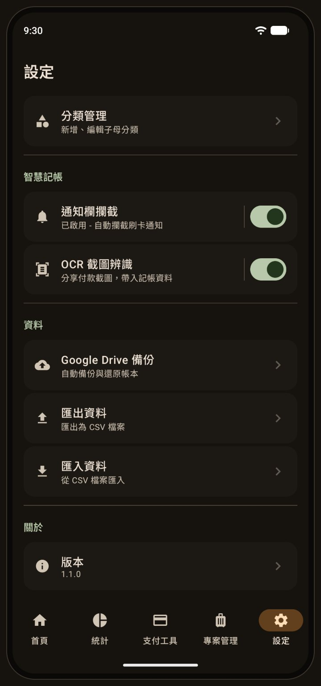<br>
      <strong>Smart capture and backup</strong><br>
      <sub>Toggle capture sources and back up to Google Drive</sub>
    </td>
  </tr>
</table>

<sub>All screenshots use a fictional demo ledger, captured on the Android Emulator.</sub>

## Features

| Area | Capabilities |
| --- | --- |
| Water budget | Draw the monthly or project budget as animated water. The level falls with spending, the colour warms as it empties, and the water tilts and sloshes with the phone. |
| Automatic capture | Turn bank and wallet notifications into drafts and confirm them from the notification. On HyperOS, captures can also appear as island notifications. |
| Transit cards | Read Suica and ICOCA ride and purchase history over NFC, import selected trips with historical JPY rates, and keep stored-value balances in sync. Track the balances of EasyCard, iPASS, and icash cards as well. |
| OCR and QR | Log shared payment screenshots, receipt photos (Chinese, Japanese, and English, with translation), and Taiwan e-invoice QR codes. Every result stays editable before you save it. |
| Cards and wallets | Calculate spending per billing cycle, track credit limits and cashback caps, and recognise more than 20 Taiwanese and international payment brands by their icons. |
| Multi-currency | Record the original currency and convert it to your account currency at the historical cash rate for the transaction date. |
| Travel projects | Give each trip its own budget, timeline, category breakdown, and transaction history. Spread large costs across several months. |
| Statistics | Switch between expenses and income by week, month, year, or all time, with trends, category shares, and savings rate. |
| Transaction details | Categories and subcategories, payment methods, line items, multi-line notes, split personal amounts, and a built-in calculator. |
| Backup and languages | Encrypted Google Drive backup (AES-GCM with a password-derived key), CSV import and export, and Traditional Chinese, English, Japanese, and Simplified Chinese UI. |

## Technology

- Kotlin and Jetpack Compose with Material 3
- Room for local persistence
- Hilt for dependency injection
- DataStore for application preferences
- CameraX and Google ML Kit for document, barcode, and text recognition
- Android NFC (FeliCa) for transit card reading
- WorkManager and the Google Drive API for scheduled, encrypted backups
- Kotlin Coroutines for asynchronous work

## Requirements

- Android Studio with JDK 17
- Android SDK 36
- Android 8.0 (API 26) or later for installation
- An NFC-capable phone to read transit cards

## Google Drive backup setup

Enable the [Google Drive API](https://console.cloud.google.com/apis/library/drive.googleapis.com) in the Google Cloud project that owns the app's OAuth clients. Configure the Google Auth consent screen with the `https://www.googleapis.com/auth/drive.appdata` scope and add any test accounts while the app is in testing.

Create an Android OAuth client for `com.rton.expensebucket` with the SHA-1 of each signing certificate used to install the app. Run `./gradlew.bat :app:signingReport` for local builds. For a Play-distributed build, use the app signing certificate listed in Play Console. Keep debug and production OAuth clients for the same app in the same Google Cloud project so they use the same Drive app data space.

In the app, open **Settings → Google Drive backup**, connect your Google account, and set a backup password. Android runs the initial backup when network access is available, then schedules a backup about every 24 hours. Keep the password to unlock backups when you restore on another device.

## Build

Clone the repository, open it in Android Studio, or run the following command from the project root:

```powershell
./gradlew.bat :app:assembleDebug
```

The debug APK is generated under `app/build/outputs/apk/debug/`.

Useful verification commands:

```powershell
./gradlew.bat :app:compileDebugKotlin
./gradlew.bat :app:testDebugUnitTest
```

If Gradle cannot find Java, set `JAVA_HOME` to the JBR bundled with Android Studio.

## Project status

Expense Bucket is an experimental personal project. Interfaces, data models, and behavior may change without backward-compatibility guarantees.

## AI-assisted development

This project is also an experiment in building an Android application through agentic AI-assisted development.  Antigravity and Codex was used. 